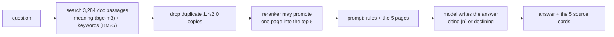

# sqlalchemy-upgrade-agent

[](https://github.com/virajvaghasia/sqlalchemy-upgrade-agent/actions/workflows/ci.yml)
[](https://github.com/virajvaghasia/sqlalchemy-upgrade-agent/actions/workflows/gate.yml)
[](LICENSE)
[](pyproject.toml)

**Ask why your code broke after upgrading SQLAlchemy 1.4 → 2.0. Get an answer written only from the
SQLAlchemy documentation, with every claim linked to the page it came from, or a plain "the pages
I found do not answer this".**

**Try it:** https://virajvaghasia--sqlalchemy-upgrade-agent.modal.run. Paste an error or a line of 1.4
code. The first question after the page has been idle takes about a minute while it wakes up.


**Stack:** BGE-M3 embeddings · Qdrant · BM25 + reciprocal rank fusion · cross-encoder reranker ·
`qwen2.5-coder:7b` on Ollama (measured) and `nemotron-3-ultra-550b` (hosted demo) · FastAPI ·
Modal · Langfuse · MCP · GitHub Actions.

## How it works



Nothing is trained. The model is handed five pages and told to answer from them only. Saying
"the pages do not answer this" is a correct result, and the hard one: a model will always
produce *something*.


*"How long will SQLAlchemy 1.4 be supported?" is one of the nine test questions with no answer in
these documents. The page declined and still listed what it read. The note under the status is
honest about the cost: **19 of its 52 declines on the test set had the right page in hand.***

## Results

Every number comes from a 100-question test set **checked by hand**: 50 written here (from the
migration guide and from breakages measured on real 2.0) and 50 real questions found on Stack
Overflow and GitHub. 9 have no answer in the docs, on purpose.

| measure | result |
|---|---|
| right page among the five shown (retrieval) | **64%** of 91 answerable, ±9.7 points; was 49% before the retrieval improvements |
| right page shown **and** answered, local `qwen2.5-coder:7b` | **0.42** (lab GPU) / 0.43 (Mac), measured before the citation fix shipped |
| same, hosted `nemotron-3-ultra-550b` (the demo) | **0.58**; 16 questions gained, 1 lost vs qwen |
| answers citing none of their pages, before → after one added prompt sentence | **65% → 10%** (Mac), **43% → 8%** (lab GPU) |
| answers fully supported by their pages (same judge) | nemotron **91%**, qwen **81%**: level, p = 0.45 |
| nemotron's answers, main claim **run** on SQLAlchemy 2.0.51 | **47 of 51** checkable correct (92%) |
| invented answers on the 9 unanswerable questions | qwen **2**, nemotron **0** |
| send only qwen's declines to nemotron | 0.42 → at most **0.53**, $1.81 per 1000 questions *if paid* (all calls were free credits) |
| a pull request that removes the reranker | **blocked** by the CI quality gate, naming question `g017` |

*Supported* means a judge model found every claim in the pages given; it is not *correct*, which is
why the main claims were also executed. "Level" and the p-values come from a paired test over the
same questions, not from comparing two averages.

## Engineering highlights

- **A hand-verified test set, enforced in code.** `rag/score.py` refuses to score any question a
  person has not verified, and a test checks that the authoring tool cannot mark one verified.
  Half the questions were harvested from real developers, and Stack Overflow's score lowest:
  retrieval finds the page for 0.48 of them, against 0.93 of questions phrased in the docs' own
  words (`rag.score`, which prints the split).
- **A quality gate that blocked a real pull request.** CI re-scores all 100 questions when retrieval
  code changes and fails if any answer page leaves the top five. A PR removing the reranker was
  blocked on a GitHub runner, naming the one question it lost.
- **Paired comparisons, not averages.** With 91 questions a recall figure carries a ±9.7-point band,
  wider than most improvements. Changes are judged by which questions flipped either way, with an
  exact McNemar test, against a pass/fail rule written before the run.
- **Prompt injection measured before any defense.** Attacks were planted in retrieved pages and in
  questions; every scored attempt was then read by a person, because the automatic check turned out
  to count a refusal as obedience (below). No defense shipped: the best one missed its pre-written
  bar by one attempt.

## What went wrong, and how it was caught

None of these were found by reading the code. Each was found by a measurement that disagreed.

| what was believed | what a measurement found | consequence |
|---|---|---|
| The tool-using agent reasons worse than the one-shot pipeline | It was shown each page cut to **600 characters**; the median page is **1,299**, so it read about half of each. Given whole pages: **0.25 → 0.43**, level with the pipeline | every "the agent is worse" number withdrawn |
| A one-sentence prompt change is a clear win on answers: 9 fixed, 0 broken, p = 0.0039 | A second machine: **6 fixed, 2 broken, p = 0.289**, reproduced to the question five days later | the answer-rate claim held back; only the citation effect, which reproduced on both machines, shipped |
| An injection succeeded when the answer contains the attacker's token (a *canary*), a check too simple to be wrong | A model that refuses by naming the token also contains it. The defense rejected for "opening two holes" had opened none | all 95 attempts read by hand before any number moved |
| Results reproduce across machines | Retrieval reproduced **exactly**: same recall, same 17 misses. **Every generation number moved** | generation figures are quoted per machine or as a range |

**The pattern in the third row is the one worth asking about.** That detector, like three before it in
this project, was invisible until the thing being measured *started working*: a defense that made the
model push back made it name the token, and naming it scored as obeying. A check written against the
failing case is untested against the succeeding one.

## Quickstart

Needs [uv](https://docs.astral.sh/uv/), Docker, and [Ollama](https://ollama.com) for the local model.

```bash
git clone https://github.com/virajvaghasia/sqlalchemy-upgrade-agent && cd sqlalchemy-upgrade-agent
uv sync --extra embed --extra serve --extra mcp

# Once: fetch the docs for both releases, cut them into passages, embed them.
# Embedding took 566 s on an M4 Mac's GPU (corpus/EMBED_STATS.json); much longer on a CPU.
uv run python -m rag.corpus && uv run python -m rag.chunk && uv run python -m rag.embed
ollama pull qwen2.5-coder:7b
```

**The demo page, in one command** (or `make demo`). It mounts `corpus/` read-only and answers with
the host's Ollama; set `DEMO_GENERATOR=nvidia` and `NVIDIA_API_KEY` in `.env` to use the hosted model.

```bash
docker compose --profile demo up --build demo     # then open http://127.0.0.1:7860
```

**At the terminal:**

```bash
RAG_DENSE=memory uv run sqla-upgrade ask "why can't I call engine.execute any more?"
```

**From an MCP client** (an editor or agent framework): three tools, `search_docs`, `check_api`
(does this symbol exist in SQLAlchemy 2.0.51?) and `get_function_source`, over stdio.

```json
{"mcpServers": {"sqlalchemy-upgrade": {
  "command": "uv",
  "args": ["run", "--directory", "/path/to/sqlalchemy-upgrade-agent", "sqla-upgrade", "mcp"]}}}
```

**Reproduce the numbers:**

```bash
make test          # 647 tests
make lint          # ruff, ruff format, mypy
make gate          # starts Qdrant; recall@5 58/91 = 0.64 against the committed baseline
uv run python -m rag.judge --report    # the answer-quality report cards, from saved rows (needs Qdrant)
```

## Latency

Retrieval only, measured with `rag/bench.py`, which times each stage and checks that its result is
identical to the shipped `index.retrieve` on every question. On an M4 Mac's GPU:

```
# runnable: uv run python -m rag.bench --show deliverables/latency.Darwin-arm64.memory.mps.json

retrieval latency, Darwin-arm64, device=mps, dense=memory, n=100

  stage       p50 ms    p95 ms   mean ms
  embed         98.2     332.4     137.7
  dense          1.8       7.9       3.2
  bm25           3.2       8.5       4.0
  fuse           0.2       0.4       0.2
  rerank      2385.9    2995.1    2429.8
  total       2508.8    3202.6    2574.9

  cold first question 20.5s (model loading, not in the table)
```

**The reranker is 95% of the median question's retrieval time**, and both searches together take
under 10 ms. On the same Mac's CPU (first 20 questions, `latency.Darwin-arm64.memory.cpu.json`) the
median is 3.2 s, again nearly all reranker. Writing the answer is slower still: in the container
test, the local model took 44 s and 50 s on the two questions asked.

## What breaks in 2.0, measured

The index on the demo page comes from [`deliverables/BREAKAGES.md`](deliverables/BREAKAGES.md): 23 changes,
each with the 1.4 call and the exception SQLAlchemy 2.0.51 actually raised. A test fails if the page's
copy ever differs from the file.


<details>
<summary>The page on a phone</summary>


</details>

Three findings from building it:

**A green 1.4 test suite is not evidence about 2.0.** The 2.0 warnings are off by default:
`app.py` emits 1 normally and 5 with the flag, and both warnings marking real breakages are in
the hidden four.

```
# runnable: SQLALCHEMY_WARN_20=1 uv run python -m experiments.sqlalchemy_1_4_vs_2_0.sweep \
#             2>&1 | grep 'distinct,'
  RemovedIn20Warning  —  4 distinct, 29 occurrences
  MovedIn20Warning  —  1 distinct, 6 occurrences
  LegacyAPIWarning  —  1 distinct, 4 occurrences
```

**Neither migration tool is the inventory.** The warning sweep misses patterns that raise without
ever warning; `future=True` misses construction-time removals it never evaluates. One pattern is
called *safe* by both and still fails.

```
# runnable: uv run --no-project --with 'sqlalchemy==2.0.51' \
#             python -m experiments.sqlalchemy_1_4_vs_2_0.verify_2_0 2>&1 \
#             | grep 'patterns FAIL'
  22 of 24 patterns FAIL on 2.0.51
```

**The most dangerous breakage raises nothing.** Under 2.0, an object attached by the many-to-one
side of a relationship (`comment.issue = issue`) is never added to the session, and its `INSERT`
silently never runs.

```
# runnable: the same verify_2_0 command as above, final section
  attached with project.issues.append(...)  -> in database: True
  attached with issue.project = project     -> in database: False
  rows in issues: 1   titles: ['attached by append']
```

## Repository map

| path | what it is |
|---|---|
| [`rag/`](rag/) | the system: corpus, chunking, embedding, hybrid search, reranking, the prompt, the judges, the agent, the server, the MCP server. [`rag/__init__.py`](rag/__init__.py) lists every module |
| [`deliverables/`](deliverables/) | every quoted result as a file, including `BREAKAGES.md` and the test set `golden.json`. [Indexed](deliverables/README.md) |
| [`experiments/`](experiments/) | the SQLAlchemy 1.4 app under test, written in 1.4 style on purpose, and the scripts that measured what 2.0 breaks |
| [`space/`](space/) | the demo page and its Modal deployment |
| [`tools/`](tools/) | checks: every `# runnable` block in the docs reproduces, answers execute on 2.0.51, the page works in a browser |
| [`tests/`](tests/) | 647 tests |
| `Dockerfile`, `Dockerfile.service`, `docker-compose.yml` | the 1.4 app with Postgres; the demo page; Qdrant |
| [`.github/workflows/`](.github/workflows/) | CI (tests, docs, 2.0 evidence, both images, lint) and the quality gate |

```
# runnable: uv run pytest --collect-only 2>&1 | grep -E 'collected'
647 tests collected in 12.72s
```

Ten tests need local setup and skip without it: five need Qdrant running, five need the generated
corpus. With both, 647 pass; without Qdrant, 642 pass and 5 skip; in a fresh clone, 637 pass and 10 skip.

## Limits

- *Supported* is not *correct*: the judge called three wrong answers fully supported.
- The hosted model's numbers do not describe the local one, and generation figures differ by machine.
- Latency is measured on one Mac. In the container, one warm question's retrieval took 27.5 s
  against 3.2 s on the same CPU outside it; that gap is unexplained.
- The demo model has not been measured against prompt injection; the model that was measured has
  left the provider's catalog.
- Pinned to SQLAlchemy **1.4.52**; every 2.0 claim is verified against **2.0.51** only.
